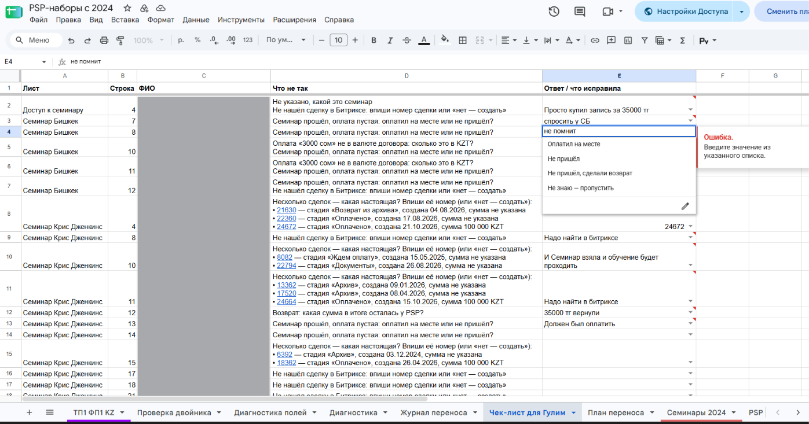

# PSP деньги

## Что это за инструмент

Google Apps Script, который переносит оплаты 2026 года из Google-таблицы «PSP-наборы» в сделки воронки PSP в Битрикс24: находит сделку клиента (или создаёт новую), заполняет её поля, добавляет счёт на уже оплаченную сумму и ставит стадию. Сначала идёт пробный прогон `dryRun`: он ничего не меняет в Битриксе, а пишет в таблицу «План переноса» и «Чек-лист для Гулим» — вопросы, на которые нужен ответ человека. Боевой перенос `liveRun` идёт только по этим ответам и за переключателем `LIVE_DRY`.

## Первое ТЗ

ВПИШУ САМ

## Что мешало

Гулим тратила слишком много времени на чек-лист — открывала каждую сделку в Битриксе вручную и писала ответы свободным текстом.

## Улучшение 1

```text
Улучшение чек-листа для Гулим.
Что не так: когда у клиента несколько сделок, в чек-листе только голые номера («21630, 22360, 24672 — какая настоящая?»). Гулим открывает каждую сделку в Битриксе вручную — это очень долго.
Как должно быть: для каждой сделки-кандидата — кликабельная ссылка на сделку в Битриксе плюс стадия, дата создания и сумма, прямо в ячейке.
Зачем: чтобы Гулим выбирала правильную сделку, не открывая Битрикс, за секунды вместо минут.
Работай только в пробном режиме (dryRun), в Битрикс ничего не пиши. Перед правкой объясни план простыми словами.
```

Что изменилось: в ячейке «Что не так» у каждой сделки-кандидата теперь кликабельный номер, стадия, дата создания и сумма (так же — в вопросе про одну старую сделку).

## Улучшение 2

```text
Для вопроса «оплатил на месте или не пришёл» варианты списка: «Оплатил на месте» / «Не пришёл» / «Не пришёл, сделали возврат» / «Не знаю — пропустить». Для остальных типов вопросов список только про пропуск, ввод номера или суммы оставь как есть. Сейчас Гулим пишет в Е «не помню», «спросить у СБ» — такие строки должны считаться пропуском и не переноситься.
```

Что изменилось: в колонке «Ответ» появился выпадающий список, а ответы «Не знаю — пропустить», «не помню», «спросить у СБ» и «Не пришёл…» скрипт считает пропуском и не переносит.

## Финальное ТЗ

```text
Задача: напиши Google Apps Script, который переносит оплаты 2026 года из Google-таблицы «PSP-наборы» в сделки воронки PSP в Битрикс24 — сначала пробным прогоном, потом боевым, только по ответам менеджера.

Контекст: данные лежат в листах потоков и семинаров таблицы. Часть строк неоднозначна: у клиента несколько сделок, найдена старая сделка, сделки нет, оплата пустая или в другой валюте. Решает менеджер (Гулим): времени у неё мало, открывать Битрикс ради каждой строки она не должна. Адрес вебхука Битрикса и ID таблицы хранятся только в свойствах скрипта, не в коде. Пока не решено иначе, в Битрикс ничего не пишется (переключатель LIVE_DRY = true).

Формат:
- dryRun ничего не меняет в Битриксе и пишет два листа: «План переноса» (что будет сделано с каждой строкой) и «Чек-лист для Гулим» (Лист, Строка, ФИО, Что не так, Ответ).
- В «Что не так» у каждой сделки-кандидата — кликабельный номер, стадия, дата создания и сумма.
- В «Ответ» — выпадающий список: на вопрос «оплатил на месте или не пришёл?» — «Оплатил на месте», «Не пришёл», «Не пришёл, сделали возврат», «Не знаю — пропустить»; на остальные вопросы — «Не знаю — пропустить». Номер сделки, «та же», «новая», «нет — создать» можно вписать вручную. При пересборке листа ответы сохраняются.
- liveRun обрабатывает не больше 3 строк за запуск и всё пишет в лист «Журнал переноса». Пропуск («Не знаю — пропустить», «не помню», «спросить у СБ», «Не пришёл…») не переносится и лимит не тратит; «Оплатил на месте» и непонятный текст ждут ручного разбора.

Готово, когда: dryRun проходит без ошибок, в чек-листе видны ссылки на сделки и выпадающие списки, прежние ответы на месте; пробный liveRun пишет в журнал «ПРОБНО: было бы сделано…» и «пропущено по ответу…», а в Битриксе ничего не меняется.
```

## Проверка

dryRun 18.11 прошёл без ошибок, 183 строки, ссылки на сделки и выпадающие списки видны в таблице.



## Что осталось

Старые ответы свободным текстом подсвечены как неверные, Гулим выберет их заново из списка.

## Вывод

ВПИШУ САМ
